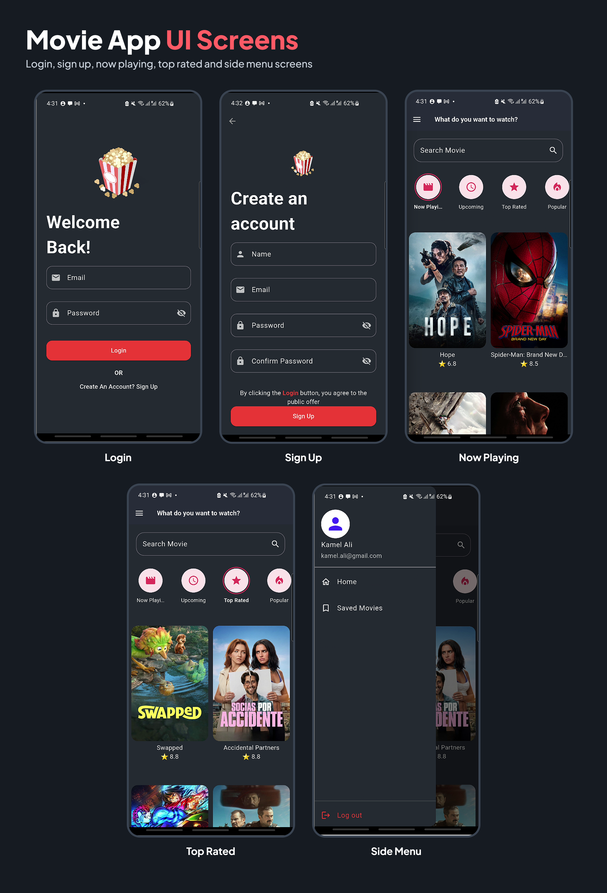

# Movie App

A Flutter movie app that shows popular and top-rated films from TMDB, with search, a watch list, and Firebase authentication.

## Screenshots

## Features
- Home screen with a top carousel and a 3-column poster grid
- Category tabs: Now Playing, Upcoming, Top Rated, Popular
- Search with results and a no-results state
- Saved (watch) list
- Register and login with Firebase Auth
- Profile drawer with logout confirmation
- Dark theme

## Tech Stack
- Flutter & Dart
- flutter_bloc (Cubit)
- dio (HTTP client)
- Firebase Authentication
- API: [TMDB](https://www.themoviedb.org/documentation/api)

## Getting Started
1. Clone the repo:
   ```bash
   git clone https://github.com/KamelAli545/MovieApp.git
   ```
2. Install dependencies:
   ```bash
   flutter pub get
   ```
3. Add your TMDB API key in `core/Apiflims.dart`. Do not commit your real key.
4. Set up Firebase with `flutterfire configure` or add `google-services.json` to `android/app/`.
5. Run the app:
   ```bash
   flutter run
   ```

## Roadmap
- [ ] Movie details screen

## Author
Kamel Ali Kamel · [LinkedIn](https://linkedin.com/in/kamel-ali03) · [GitHub](https://github.com/KamelAli545)
